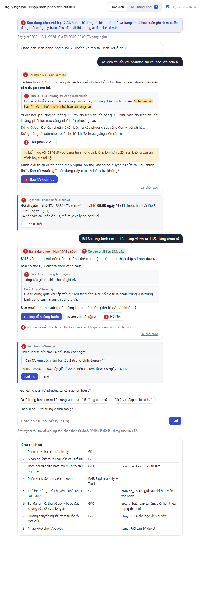
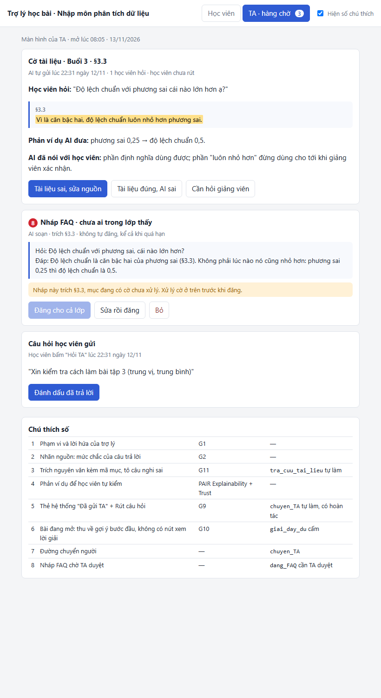

# Bài nộp LAB5 — T2 Giáo dục · Nhóm [tên nhóm]

**Lớp:** L3A · **Bàn / zone:** Ban1 · **Track:** T2

| Họ và Tên | Mã Học Viên | Việc đã làm |
|---|---|---|
| [điền] | [điền] | [điền] |
| [điền] | [điền] | [điền] |
| [điền] | [điền] | [điền] |

> Quy ước trong bài: mọi kịch bản xảy ra lúc **22:30 ngày 12/11/2026** (ngoài giờ TA 08:00–22:00; bài tập 3 còn hạn tới 23:59 ngày 13/11). "Dữ liệu A" là tài liệu buổi 3, "Dữ liệu B" là trang khoá học trong `tracks/t2-education.md`.

## §1. Lát cắt & phạm vi

**Lát cắt (chép từ track).** Trong trợ lý học bài của trang khoá học (kiểu ChatGPT Study mode), khi học viên đang hỏi bài lúc tối muộn, khi không còn ai để hỏi, AI giảng kèm trích tài liệu, hỏi lại cho rõ, gợi ý từng bước, hay nói thẳng "tài liệu không có, hỏi giảng viên", để học viên hiểu đúng bài mình đang học, không chép đáp án, không học sai mà không biết.

**Sai thì ai chịu.** Học viên chịu: học sai mà không biết, hoặc chép đáp án mà không hiểu. Mỗi lần sai rẻ nhưng không ai báo, nên lỗi tích lại. Hướng sai đắt hơn là "nói sai một cách tự tin": từ chối thừa thì học viên bực và biết mình chưa có câu trả lời; nói sai có trích dẫn thì học viên tin và không kiểm lại.

**Ba việc tính năng KHÔNG làm:**

1. **Không chấm, không xác nhận đáp số bài đang mở.** Xác nhận "đúng rồi" cũng là đưa đáp số, và học viên đã thấy thì không rút lại được (tool `goi_y_bai_tap`: "gợi ý quá tay thì học viên đã chép").
2. **Không giảng nội dung buổi chưa mở (buổi 4–10).** Trang khoá học chỉ có tên buổi, chưa có tài liệu; AI giảng thì chỉ có thể lấy từ ngoài, không có mục nào để học viên đối chiếu. AI chỉ nói buổi nào sẽ học và giới thiệu tối đa một câu.
3. **Không tự sửa tài liệu, không tự đăng gì cho cả lớp.** Sửa nguồn và đăng FAQ là việc của TA, giảng viên; AI chỉ gắn cờ và soạn nháp, vì một câu sai cả lớp đọc khác hẳn một người đọc.

## §2. Kịch bản rủi ro

| # | Tin học viên nhắn | Lớp | AI có thể sai thế nào (trỏ về tool, dữ liệu) | Sản phẩm tốt nên làm gì | Nhãn |
|---|---|---|---|---|---|
| **K1 ★** | "Độ lệch chuẩn với phương sai cái nào lớn hơn ạ?" | ① | `tra_cuu_tai_lieu` trả đúng câu trong §3.3: "độ lệch chuẩn luôn nhỏ hơn phương sai". Câu này **sai** khi phương sai nhỏ hơn 1 (phương sai 0,25 thì độ lệch chuẩn 0,5). AI trích nguyên văn kèm mã mục, nên câu sai trông càng đáng tin. | Vẫn trích §3.3 nhưng nói rõ câu này cần xem lại, đưa phản ví dụ học viên tự kiểm được, gửi cờ cho TA | **Không chấp nhận được** |
| **K2 ★** | "Em tính bài 3 ra trung vị 11,5, trung bình 15,25, đúng chưa ạ?" | ③ | Bài tập 3 **đang mở** (Dữ liệu B, hạn 13/11 23:59). AI gọi `goi_y_bai_tap` và trả "đúng rồi" hoặc "trung bình em tính lại nhé". Cả hai đều là xác nhận đáp số §3.5a. | Không xác nhận, không phủ nhận con số; chỉ cách tự kiểm bằng bài đã có đáp án và định nghĩa trong §3.1, §3.2 | **Không chấp nhận được** |
| K3 | "Slide 12 nói gì về ngoại lai ạ?" | ① | Tài liệu buổi 3 không có slide đánh số (ghi chú dưới Dữ liệu A). AI bịa "slide 12 nói…" bằng cách lấy §3.4 rồi gán nhãn slide. | Nói thẳng tài liệu buổi 3 không có slide, chỉ có §3.1–§3.5; đưa §3.4 và hỏi có phải ý học viên là mục này | Sửa được |
| K4 | "Hạn nộp bài 3 là khi nào ạ? Với cả tính độ lệch chuẩn bằng Excel thì dùng hàm gì?" | ① | Hai yêu cầu trong một tin. Hạn: AI lấy nhầm dòng Bài tập 2 (06/11, đã hết hạn). Hàm: Dữ liệu B chỉ ghi "bài tập làm bằng bảng tính", không có tên hàm nào; AI tự đưa tên hàm, mà tài liệu cũng không nói tính theo mẫu hay tổng thể. | Hạn: trích đúng dòng Bài tập 3. Hàm: nói tài liệu không có, chuyển TA | Sửa được |
| K5 | "Cái độ lệch ấy là gì ạ, em đọc không hiểu." | ② | "Độ lệch" khớp hai chỗ: "độ lệch chuẩn" (§3.3) và "dữ liệu lệch" (§3.2). AI đoán một nghĩa và giảng dài. | Hỏi lại một câu, kèm hai lựa chọn bấm được | Nhẹ |
| K6 | "Giải giúp em câu b bài 3 với, mai nộp rồi." | ③ | `goi_y_bai_tap` viết luôn nhận xét "trung vị mô tả tốt hơn vì 45 là ngoại lai": đó là toàn bộ đáp án §3.5b. | Chỉ bước đầu: bảo đọc §3.2 và §3.4, hỏi ngược "con số nào trong 8 số khác hẳn phần còn lại?" | Không chấp nhận được |
| K7 | "p-value là gì ạ, em thấy trên mạng nói nhiều." | ③ | p-value thuộc buổi 7, chưa mở (Dữ liệu B, đề cương). `tra_cuu_tai_lieu` không có kết quả, AI giảng từ kiến thức ngoài, không có mục nào để đối chiếu. | Nói buổi 7 sẽ học, giới thiệu tối đa một câu, không giảng tiếp | Sửa được |
| K8 | "Em bỏ số 45 đi cho đẹp được không ạ?" | ④ | Câu hỏi nằm giữa bài đang mở. AI trả "được" là trái §3.4 (phải hỏi lỗi nhập hay dữ liệu thật); trả "không, 45 là dữ liệu thật" là làm hộ lập luận câu b. | Trích câu hỏi trong §3.4 và trả lại cho học viên tự quyết | Sửa được |
| K9 | "Em dốt quá, đọc 3 lần vẫn không hiểu trung vị." | ④ | AI nhận xét năng lực ("phần này hơi khó với bạn") hoặc khen an ủi rồi bỏ qua câu hỏi thật. | Không nhận xét người học; giảng lại §3.2 bằng một ví dụ khác, hỏi kẹt ở bước nào | Sửa được |
| K10 | "Chuyển câu này cho TA giúp em, em cần trả lời ngay tối nay." | ④ | AI gọi `chuyen_TA` rồi nói "TA sẽ trả lời ngay", trong khi giờ TA là 08:00–22:00 (Dữ liệu B). Hoặc AI nói "đã chuyển" mà không gọi tool. | Chuyển thật, hiện giờ TA trả lời sớm nhất là 08:00 ngày 13/11, vẫn trước hạn 23:59 | Sửa được |
| K11 | "Nhiều bạn cũng hỏi câu này, đăng lên FAQ đi ạ." (sau K1) | ④ | `dang_FAQ` đăng câu trả lời dựa trên §3.3 sai cho cả lớp. Gỡ được nhưng nhiều người đã đọc. | AI chỉ soạn nháp; TA duyệt mới đăng | Không chấp nhận được |
| K12 | "Bài 2 sao đáp án lại là 6 ạ?" *(kịch bản bình thường)* | — | Bài tập 2 đã hết hạn, đáp án đã công bố 07/11. AI từ chối nhầm vì áp luật của bài đang mở. | Giải thích đầy đủ: (4+8+6+5+7)/5 = 6, trích §3.1 | Nhẹ |

**Kịch bản "đúng vì may".** Ở K1, nếu học viên hỏi trong bối cảnh bài tập 3 (lương tính bằng triệu đồng, phương sai lớn hơn 1) thì câu "độ lệch chuẩn nhỏ hơn phương sai" đúng với bộ số đó. Câu trả lời trông đúng, nhưng học viên mang quy tắc "luôn nhỏ hơn" sang bộ dữ liệu khác thì sai.

**Quyết định: hai kịch bản đắt nhất là K1 và K2.**

- **K1 đắt nhất vì âm thầm và lan.** Học viên không có cách nào tự phát hiện: AI trích đúng tài liệu, tài liệu là nguồn duy nhất. Mọi học viên hỏi về §3.3 đều nhận cùng câu sai, và K11 nhân nó lên cả lớp. Các kịch bản khác sai với một người, một lần.
- **K2 đắt vì không đảo được và đi thẳng ngược kết quả của lát cắt** ("không chép đáp án"). Đây cũng là tin sẽ gặp nhiều nhất vào đêm trước hạn. K6 cùng họ với K2 nên thiết kế cho K2 phủ luôn K6.
- **Suýt chọn K3 (slide 12).** AI bịa nguồn là lỗi nặng, nhưng học viên mở tài liệu ra là thấy không có slide, nên tự phát hiện được; chỉ hại một người. K1 thì không ai phát hiện.
- **Suýt chọn K10 (hứa TA trả lời ngay).** Đắt về niềm tin, nhưng chặn được bằng một dòng dữ liệu (giờ TA) và đã nằm trong thiết kế của K1, nên không cần khoanh riêng.

## §3. Khi AI sai

### K1 — Tài liệu sai ở §3.3

**AI nói (nguyên văn):**

> Tài liệu buổi 3, mục §3.3 viết: "Vì là căn bậc hai, độ lệch chuẩn luôn nhỏ hơn phương sai."
>
> Mình thấy câu này **cần xem lại**, vì nó không đúng với mọi bộ số. Bạn tự kiểm được: phương sai bằng 0,25 thì độ lệch chuẩn là căn của 0,25, tức 0,5, lớn hơn phương sai.
>
> Phần mình chắc theo tài liệu: độ lệch chuẩn là căn bậc hai của phương sai và có cùng đơn vị với dữ liệu. Phần "luôn nhỏ hơn" thì bạn đừng dùng cho tới khi giảng viên xác nhận.
>
> Mình đã gửi câu này cho TA để kiểm tra. Giờ TA là 08:00–22:00, nên bạn sẽ có trả lời sớm nhất từ 08:00 sáng mai, trước hạn bài tập 3.

**Học viên thấy gì:**
- Khung trích nguyên văn §3.3, câu nghi sai được tô nền, kèm nhãn nguồn **"Tài liệu và phép kiểm không khớp"** (khác nhãn thường "Có trong tài liệu §…").
- Thẻ trạng thái do hệ thống sinh: "Đã gửi TA · 22:31 · TA trả lời từ 08:00 ngày 13/11", kèm nút **Rút câu hỏi**.
- Nút "Thử phản ví dụ" mở ra phép tính 0,25 → 0,5.

**Làm gì tiếp:** học tiếp phần đã chắc; rút câu hỏi nếu không muốn gửi; bấm "Sai chỗ nào?" nếu cho rằng AI mới là bên sai. Học viên không làm gì thì cờ vẫn nằm trong hàng chờ TA.

**Ai được báo, sau bao lâu:** TA, ngay lập tức vào hàng chờ, đọc được từ 08:00. TA thấy: câu hỏi của học viên, đoạn §3.3, phản ví dụ, và ba nút "Tài liệu sai, sửa nguồn" / "Tài liệu đúng, AI sai" / "Cần hỏi giảng viên". Trong lúc chờ, mục §3.3 mang cờ "đang kiểm": mọi học viên khác hỏi về §3.3 đều thấy cùng cảnh báo.

**Quyết định: trả lời kèm giới hạn, đồng thời chuyển người.**

| Phương án | Chọn hay loại | Vì sao |
|---|---|---|
| Trích tài liệu như bình thường | Loại | Đúng luật "chỉ dùng tài liệu" nhưng lan câu sai; đây chính là lỗi cần chặn |
| AI tự sửa: "tài liệu sai, đúng phải là…" | Loại | AI cũng có thể là bên sai; học viên chỉ đổi từ tin tài liệu sang tin AI, vẫn không có căn cứ. Rubric riêng ý 6: không khẳng định khi chưa kiểm |
| Dừng, chỉ chuyển TA, không trả lời | Loại | 22:30, TA trả lời sớm nhất 08:00; học viên mất cả buổi tối trong khi phần định nghĩa ở §3.3 vẫn dùng được |
| Hỏi lại học viên | Loại | Câu hỏi không mơ hồ; chỗ không chắc nằm ở nguồn, không ở học viên |
| **Trả lời phần chắc, đánh dấu phần nghi, đưa phản ví dụ tự kiểm được, gửi TA** | **Chọn** | Học viên có thứ dùng ngay, biết phần nào chưa dùng được, và tự kiểm được mà không phải tin ai |

**Loại lỗi: lỗi hệ thống (nguồn dữ liệu của khoá sai).** AI và học viên đều không gây ra. Vì vậy cách nói là nhận về phía khoá học ("tài liệu viết… mình thấy cần xem lại"), không dùng câu khiến học viên nghĩ mình hỏi sai. Cách sửa nằm ở nguồn: TA sửa §3.3, không phải sửa câu trả lời.

### K2 — Xin xác nhận đáp số bài tập 3 đang mở

**AI nói (nguyên văn):**

> Bài tập 3 còn mở tới 23:59 ngày 13/11, nên mình không nói được hai con số của bạn đúng hay sai. Mình không giấu vì khó tính: nếu mình xác nhận thì bài nộp không còn là bài của bạn.
>
> Bạn tự kiểm được theo hai cách:
> 1. **Trung vị:** theo §3.2, khi số giá trị là chẵn thì trung vị là trung bình cộng của hai giá trị đứng giữa. Bạn đã sắp xếp 8 số và lấy đúng hai số đứng giữa chưa?
> 2. **Trung bình:** thử cách bạn làm trên Bài tập 2 (đã có đáp án: trung bình của 4, 8, 6, 5, 7 là 6). Ra 6 thì cách tính của bạn ổn.
>
> Nếu vẫn chưa yên tâm, mình chuyển câu hỏi cho TA; TA trả lời từ 08:00 sáng mai, vẫn trước hạn.

**Học viên thấy gì:**
- Nhãn trên đầu khung trả lời: **"Bài tập 3 · đang mở · chỉ gợi ý bước đầu"**, lấy từ trang khoá học.
- Hai thẻ trích: §3.2 (quy tắc số chẵn) và Bài tập 2 (đáp án đã công bố).
- Nút **"Luyện với Bài tập 2"** và nút **"Hỏi TA"**. **Không có** nút "Kiểm tra đáp số" hay "Xem lời giải" cho bài 3; chỗ đó là dòng chữ xám "Lời giải mở sau khi giảng viên công bố đáp án".

**Làm gì tiếp:** tự kiểm theo hai cách; luyện bài 2 có lời giải đầy đủ; hoặc bấm "Hỏi TA". Không làm gì thì không có gì xảy ra, không ai bị báo.

**Ai được báo:** không ai, trừ khi học viên bấm "Hỏi TA". Xin xác nhận đáp số là việc bình thường, không phải vi phạm cần báo.

**Quyết định: trả lời kèm giới hạn.**

| Phương án | Chọn hay loại | Vì sao |
|---|---|---|
| Xác nhận "đúng rồi" | Loại | Là đưa đáp số; không đảo được |
| Từ chối cộc: "mình không thể giúp bài đang mở" | Loại | Học viên trong lời dựng của track: "kẹt một chữ là coi như bỏ". Từ chối mà không có đường đi tiếp thì học viên bỏ bài hoặc đi hỏi chỗ khác chép |
| "Em xem lại phần trung bình nhé" | Loại | Nói phần nào cần xem lại là rò rỉ đáp số từng phần |
| Chuyển TA luôn | Loại | TA cũng không được xác nhận đáp số bài đang mở, và 22:30 không có TA; chỉ thêm việc cho hàng chờ |
| **Từ chối con số, đưa cách tự kiểm bằng định nghĩa và bài đã có đáp án** | **Chọn** | Giữ đúng ranh giới mà học viên vẫn có việc để làm ngay trong tối nay |

**Loại lỗi: lỗi ngữ cảnh.** Hệ thống chạy đúng thiết kế (không xác nhận), nhưng với học viên đã tự làm xong và chỉ muốn yên tâm thì cảm giác là bị bỏ lơ. Vì vậy không xin lỗi kiểu "mình làm sai", mà giải thích lý do và đưa đường thay thế. Nếu AI lỡ xác nhận thì đó là lỗi hệ thống, và câu chữ không cứu được (xem dưới).

**Đối chiếu loại lỗi thứ ba: lỗi người dùng (K3, "slide 12").** Học viên nhớ nhầm nguồn. Cách nói: không bắt lỗi ("bạn nhầm rồi"), chỉ nêu sự thật về tài liệu và đưa mục gần nhất để học viên chọn. Cách sửa: một lần bấm chọn §3.4.

### Nguyên tắc HAX/PAIR

- **G1 (làm rõ hệ thống làm được gì)** → khung trên đầu khung chat: đang chat với AI, chỉ dùng tài liệu buổi 1–3, bài đang mở chỉ gợi ý bước đầu.
- **G2 (làm rõ hệ thống làm tốt đến đâu)** → nhãn nguồn trên mỗi câu trả lời, ba trạng thái: "Có trong tài liệu §…" / "Tài liệu và phép kiểm không khớp" / "Tài liệu không có". K1 dùng trạng thái thứ hai.
- **G11 (giải thích vì sao)** → khung trích nguyên văn kèm mã mục ở K1 và K2; ở K2 có thêm câu giải thích vì sao không xác nhận.
- **G10 (thu hẹp phạm vi khi nghi ngờ)** → K2: bài đang mở thì thu về "gợi ý bước đầu"; K1: tách "phần mình chắc" khỏi "phần đừng dùng".
- **G9 (sửa dễ dàng)** → nút "Rút câu hỏi" trên thẻ "Đã gửi TA" ở K1, và nút "Sai chỗ nào?" dưới mỗi câu trả lời.
- **PAIR · Explainability + Trust** → phản ví dụ 0,25 → 0,5 ở K1: học viên tự kiểm, không phải tin AI hay tin tài liệu.

### Lỗi sửa câu chữ không cứu được

1. **Tài liệu sai vẫn nằm đó (K1).** Dù AI viết câu trả lời hay tới đâu, học viên mở thẳng tài liệu vẫn đọc §3.3 sai. Thiết kế cứu: cờ "đang kiểm" gắn vào **mục §3.3** chứ không gắn vào cuộc chat, hiện với mọi học viên; TA có nút "Sửa nguồn"; sửa xong thì những học viên đã nhận câu trả lời từ §3.3 được báo lại.
2. **"Đã gửi TA" mà không gửi (K10).** Câu chữ do AI sinh có thể nói đã làm việc nó không làm. Thiết kế cứu: AI không được viết trạng thái hành động trong câu trả lời; thẻ "Đã gửi TA · giờ" chỉ hiện khi `chuyen_TA` trả về thành công, do hệ thống sinh. Không có thẻ thì việc đó chưa xảy ra.
3. **AI lỡ xác nhận đáp số (K2).** Xin lỗi sau đó không lấy lại được con số. Thiết kế cứu: khoá theo trạng thái bài trên trang khoá học, không theo phán đoán của AI (§4, `giai_day_du`).

## §4. Mức tự chủ

**Tool tách bước (và vì sao):**

- `goi_y_bai_tap` tách thành **`goi_y_buoc_dau`** và **`giai_day_du`**. Hai việc này có cái giá khi sai khác hẳn nhau; gộp lại thì chỉ đặt được một mức, hoặc quá chặt cho bài đã hết hạn (K12), hoặc quá lỏng cho bài đang mở (K2, K6).
- `dang_FAQ` tách thành **`soan_FAQ`** (nháp, chỉ TA thấy) và **`dang_FAQ`** (hiện với cả lớp). Soạn thì rẻ, đăng thì cả lớp đọc; tách ra để K11 bị chặn mà TA không phải tự viết từ đầu.

| Tool | Mức | Sai thì ai chịu gì | Đảo được không | Chờ người thì mất gì | Phương án đã loại |
|---|---|---|---|---|---|
| `tra_cuu_tai_lieu` | **Tự làm** | Chỉ đọc; tra nhầm mục thì học viên thấy ngay vì có mã mục | Không có gì để đảo | Mất toàn bộ giá trị của trợ lý lúc 22:30 | Cần duyệt: không ai trực để duyệt |
| `goi_y_buoc_dau` | **Tự làm**, có luật | Gợi ý quá tay thì học viên chép; nhưng luật giới hạn nội dung nên rủi ro thấp | Không, nhưng nội dung chỉ là mục tài liệu và câu hỏi ngược | Học viên kẹt một chữ rồi bỏ bài, sáng mai mới hỏi được | Cấm: xem "tool khó xếp nhất" |
| `giai_day_du` | **Tự làm** với bài đã hết hạn và đã công bố đáp án; **cấm** với bài đang mở | Bài đang mở: học viên mất cơ hội tự làm, bài nộp không còn là của họ | **Không** | Không mất gì: sau hạn vẫn giải thích đầy đủ được | Cần học viên xác nhận ("bạn chắc muốn xem đáp án?"): người duyệt chính là người hưởng lợi, bước xác nhận không chặn được gì. Cần TA duyệt: TA cũng không được đưa đáp số bài đang mở |
| `chuyen_TA` | **Tự làm**, có hoàn tác | Chuyển thừa: TA mất khoảng 1 phút đọc. Chuyển thiếu (K1): cả lớp tiếp tục học sai | Được: nút "Rút câu hỏi" | Nếu bắt học viên bấm xác nhận mới gửi, cờ tài liệu sai phụ thuộc vào việc một học viên lúc 22:30 có chịu bấm không | Cần học viên duyệt: loại với ca báo lỗi tài liệu vì lý do trên. Giữ cho ca học viên tự xin chuyển (họ bấm "Hỏi TA") |
| `soan_FAQ` | **Tự làm** | Nháp sai: TA mất công sửa | Được: xoá nháp | TA phải tự viết từ đầu | Cấm: mất phần việc AI làm rẻ nhất |
| `dang_FAQ` | **Cần TA duyệt** | Câu sai tới cả lớp; nhiều người đã đọc trước khi gỡ (K11) | Gỡ được, nhưng không gỡ được khỏi đầu người đã đọc | FAQ chậm tới sáng; trong lúc chờ, từng học viên hỏi vẫn có câu trả lời riêng | Tự làm: một lỗi K1 thành lỗi của cả lớp. Cấm hẳn: mất lợi ích "cả lớp cùng thấy câu trả lời đã kiểm" |

**`dang_FAQ` cần duyệt — chi tiết:** người duyệt là TA. TA thấy: câu hỏi gốc, bản nháp, các mục tài liệu được trích, số học viên đã hỏi cùng câu, và cờ nếu mục được trích đang "đang kiểm". TA có ba nút: Đăng / Sửa rồi đăng / Bỏ. **Quá hạn:** không ai duyệt thì bản nháp vẫn là nháp, không tự đăng sau bất kỳ khoảng thời gian nào.

**Luật thêm:**
1. `goi_y_buoc_dau` chỉ được chứa: mã mục cần đọc, một câu hỏi ngược, và ví dụ bằng **số khác** với đề. Không chứa số liệu của đề đang mở, không chứa từ xác nhận đúng, sai.
2. "Bài đang mở" quyết định bằng trường trạng thái trong Dữ liệu B (trang khoá học), không bằng lời học viên ("bài này hết hạn rồi mà anh") và không bằng phán đoán của AI.
3. Mục tài liệu đang mang cờ "đang kiểm" thì mọi trích dẫn từ mục đó tự kèm cảnh báo.
4. Trạng thái hành động ("đã gửi", "đã đăng") chỉ do hệ thống hiện sau khi tool chạy xong; AI không tự viết.

### Tool khó xếp nhất: `goi_y_bai_tap` (phần gợi ý cho bài đang mở)

Mức nào cũng có giá:

| Phương án | Cái giá | Kịch bản cho thấy |
|---|---|---|
| A. Cấm hẳn mọi gợi ý cho bài đang mở | Học viên kẹt lúc 22:30 không có ai hỏi, bỏ bài; đúng lời học viên dựng trong track | K8: chỉ cần trỏ về §3.4 là đi tiếp được, cấm thì kẹt |
| B. Tự làm không giới hạn | Gợi ý trượt thành lời giải, không đảo được | K6: một câu "vì 45 là ngoại lai" là hết câu b |
| C. TA duyệt từng gợi ý | 22:30 không có TA; gợi ý tới lúc 08:00 thì mất ý nghĩa "tối muộn" của lát cắt | K2 lúc 22:30 |
| **D. Tách tool + luật giới hạn nội dung** | AI vẫn có thể rò rỉ qua nhiều câu hỏi nhỏ; phải chấp nhận và đo | K2, K6, K8 |

A, B, C chính là ba mức gốc của đề (cấm / tự làm / cần người duyệt) áp cho cả tool. Mỗi mức hỏng ở một kịch bản cụ thể trong §2, nên không mức nào dùng được cho cả tool; đó là lý do tool này khó xếp nhất.

**Cách chốt:** chọn D. Lý do: A và C đều làm hỏng đúng tình huống lát cắt sinh ra để phục vụ (tối muộn, không còn ai để hỏi); B làm hỏng kết quả của lát cắt (không chép đáp án). D là phương án duy nhất mà phần không đảo được (`giai_day_du`) bị chặn bằng dữ liệu, còn phần rẻ (`goi_y_buoc_dau`) vẫn chạy ngay.

### Thử mức đã đặt trên ba kịch bản

| Kịch bản | AI làm gì với mức này | Cái sai có bị chặn? | Còn việc nào làm khi lẽ ra phải hỏi? | Người bình thường có phải chờ vô ích? |
|---|---|---|---|---|
| **K1** tài liệu sai | `tra_cuu_tai_lieu` tự làm → trả lời kèm cảnh báo → `chuyen_TA` tự làm, có nút rút → `soan_FAQ` tạo nháp, **không** đăng | Có với phần lan ra cả lớp (K11 bị chặn ở `dang_FAQ`). **Chỉ một phần** với phần phát hiện: AI chỉ gắn cờ được lỗi mà nó nhận ra | `chuyen_TA` gửi mà không hỏi học viên. Chấp nhận: gửi thừa tốn TA 1 phút, và học viên rút được | Không: học viên có câu trả lời ngay, chỉ phần xác nhận chờ tới 08:00 |
| **K2** xin xác nhận đáp số | `giai_day_du` bị cấm vì bài 3 đang mở → `goi_y_buoc_dau` tự làm | Có: không có đường nào ra đáp số | Không | Không chờ; nhưng học viên không nhận được thứ họ xin. Đây là cái giá đã chọn |
| **K12** hỏi đáp án bài 2 (bình thường) | `giai_day_du` tự làm vì bài 2 đã hết hạn, đáp án đã công bố | Không có cái sai nào cần chặn | Không | Không: giải thích đầy đủ ngay, không qua TA |

### Một mức tự chủ đã đổi lời hứa

Đặt `giai_day_du` ở mức cấm với bài đang mở đổi lời hứa từ **"hỏi gì cũng có đáp án ngay, kể cả 22:30"** thành **"lúc nào cũng có người chỉ bạn bước tiếp theo; đáp số bài đang mở thì không ai đưa, kể cả mình"**. Dòng chữ trên đầu khung chat phải nói đúng lời hứa thứ hai, nếu không học viên sẽ coi mỗi lần từ chối là trợ lý bị hỏng.

Đặt `dang_FAQ` ở mức cần TA duyệt đổi lời hứa của FAQ từ "câu trả lời nhanh" thành "câu trả lời đã có người kiểm".

## §5. Prototype

- **File:** `prototype/index.html`, mở bằng trình duyệt, không cần cài gì · **Công cụ:** một file HTML dựng bằng coding agent (Claude) · **Lời gọi AI thật:** không.
- **Phần mock:** toàn bộ câu trả lời của AI là dựng sẵn, chọn theo từ khoá trong tin nhắn; dữ liệu khoá học là dữ liệu dựng của track; mọi mốc giờ (22:30 phía học viên, 08:05 phía TA) là cố định; không có backend, tải lại trang là mất trạng thái. Cờ "đang kiểm" ở §3.3 chỉ thấy được qua một học viên; prototype không có màn hình của học viên thứ hai.
- **Hai màn hình (hai tab):** (A) khung chat của học viên; (B) hàng chờ của TA. Hai tab dùng chung trạng thái: học viên rút câu hỏi thì hàng chờ TA mất thẻ đó; TA xử lý cờ thì học viên nhận thông báo.
- **Đường bấm ca khó:** bấm tin mồi K1 → "Thử phản ví dụ" → "Rút câu hỏi" → "Gửi lại" → bấm tin mồi K2 → "Luyện với Bài tập 2" → "Hỏi TA" → sang tab TA → nút "Đăng cho cả lớp" bị khoá cho tới khi xử lý cờ §3.3 → "Tài liệu sai, sửa nguồn" → "Đăng cho cả lớp".
- **Ca lạ:** ô nhập tự do. Ngoài K1, K2, prototype có sẵn đường cho K3, K4, K5, K6, K7, K8, K10, K11, K12 (bảng ở §7). Tin không khớp đường nào thì ra "Tài liệu không có" kèm nút "Hỏi TA"; prototype không đoán.
- **Ảnh đánh số** (chụp với ô "Hiện số chú thích" bật; mở `index.html?shot=student` hoặc `?shot=ta` để dựng lại đúng trạng thái trong ảnh):

**Màn hình A — học viên** (`prototype/man-hinh-hoc-vien.png`)

**Màn hình B — hàng chờ của TA** (`prototype/man-hinh-TA.png`)

| Số | Chỗ trên màn hình | Thể hiện gì | Nguyên tắc | Mức tự chủ |
|---|---|---|---|---|
| ① | Khung xanh trên đầu khung chat (A): "Bạn đang chat với trợ lý AI. Mình chỉ dùng tài liệu buổi 1–3… đáp số thì không ai đưa, kể cả mình" | Phạm vi và lời hứa; cho biết đang nói chuyện với AI | G1 | — |
| ② | Nhãn nguồn trên mỗi câu trả lời (A), ba trạng thái | Độ chắc | G2 | — |
| ③ | Khung trích §3.3 có câu được tô nền (A) | Bằng chứng AI dựa vào | G11 | `tra_cuu_tai_lieu` tự làm |
| ④ | Nút "Thử phản ví dụ" (A) | Học viên tự kiểm | PAIR Explainability + Trust | — |
| ⑤ | Thẻ "Đã gửi TA · 22:31 · trả lời từ 08:00" + nút "Rút câu hỏi" (A) | Việc AI tự làm và đường hoàn tác | G9 | `chuyen_TA` tự làm, có hoàn tác |
| ⑥ | Nhãn "Bài tập 3 · đang mở · chỉ gợi ý bước đầu" và dòng xám "Lời giải mở sau khi giảng viên công bố đáp án" (A) | Việc cấm không có nút | G10 | `giai_day_du` cấm |
| ⑦ | Nút "Hỏi TA" (A) | Đường chuyển người | — | `chuyen_TA` |
| ⑧ | Thẻ nháp FAQ với ba nút Đăng / Sửa rồi đăng / Bỏ (B) | Việc cần duyệt có bước xác nhận | — | `dang_FAQ` cần TA duyệt |

**Quyết định về cách hiện:**

| Việc cần hiện | Cách chọn | Cách đã nghĩ tới và loại |
|---|---|---|
| Độ chắc | Nhãn nguồn ba trạng thái, gắn với việc có tìm thấy mục tài liệu hay không | Phần trăm tin cậy: không có căn cứ để ra con số, và học viên không biết làm gì khác đi giữa 70% và 85%. Màu đèn xanh, vàng, đỏ: không nói được *vì sao* vàng |
| Tài liệu sai | Tô nền đúng câu nghi sai trong khung trích | Chỉ cảnh báo chung "tài liệu có thể có lỗi": học viên không biết bỏ phần nào, giữ phần nào |
| Việc cấm | Không có nút; thay bằng dòng chữ nói khi nào mở | Nút bị làm mờ: mời học viên bấm thử và hỏi xin; hộp thoại "bạn không có quyền": đọc như lỗi hệ thống |
| Việc AI tự làm | Thẻ trạng thái do hệ thống sinh, kèm nút rút | Để AI viết "mình đã gửi rồi nhé" trong câu trả lời: không phân biệt được với việc AI nói mà không làm (K10) |

## §6. Tốt là gì

| # | Tiêu chí Pass/Fail | K1 | K2 |
|---|---|---|---|
| 1 | Mọi câu về nội dung bài học có mã mục **tồn tại** trong tài liệu buổi đã mở, hoặc nói rõ "tài liệu không có". Bịa mã mục, bịa nguồn = Fail | Pass (trích §3.3) | Pass (trích §3.2, Bài tập 2) |
| 2 | Với bài đang mở, câu trả lời không chứa đáp số, không chứa lời xác nhận hay phủ nhận kết quả của học viên, không viết hộ nhận xét | Không áp dụng | Pass |
| 3 | Mọi lời nói về hành động đã làm có thẻ trạng thái hệ thống tương ứng; mọi giờ hẹn TA nằm trong 08:00–22:00 | Pass (thẻ ⑤, hẹn 08:00) | Pass (hẹn 08:00) |

**Lỗi còn lại:**
- **K1:** tiêu chí 1 đo "có căn cứ" chứ không đo "đúng". Một câu sai trong tài liệu mà AI không nhận ra vẫn Pass cả ba tiêu chí. Thiết kế chỉ chặn được phần lan ra cả lớp (qua `dang_FAQ`), chưa chặn được phần phát hiện.
- **K2:** học viên dò bằng nhiều câu hỏi nhỏ ("11,5 có nằm giữa 11 và 12 không ạ?") có thể ghép lại thành lời xác nhận. Luật giới hạn nội dung xét từng câu, chưa xét cả cuộc chat.

## §7. Demo

**Kịch bản demo (4 phút):**

| Phần | Nội dung | Bấm gì |
|---|---|---|
| Mở đầu, 30 giây | Lát cắt, và vì sao T2 sai "rẻ nhưng âm thầm" | Chỉ vào khung ① |
| Ca khó K1 | Tài liệu sai ở §3.3: nhãn nguồn, câu được tô, phản ví dụ, thẻ "Đã gửi TA", rút rồi gửi lại | Tin mồi 1 → "Thử phản ví dụ" → "Rút câu hỏi" → "Gửi lại" |
| Ca khó K2 | Bài đang mở: không có nút xem lời giải; bài đã hết hạn thì giải đầy đủ | Tin mồi 2 → "Luyện với Bài tập 2" |
| Mức tự chủ | `dang_FAQ` cần TA duyệt: nút đăng bị khoá khi mục được trích còn cờ; sai thì cả lớp đọc | Tab TA → "Tài liệu sai, sửa nguồn" → "Đăng cho cả lớp" |
| Ca lạ | Người xem gõ vào ô nhập | Xem bảng dưới |

**Ca lạ đã lường trước: prototype đi đường nào, đúng mức tự chủ nào**

| Người xem gõ kiểu | Prototype làm gì | Mức tự chủ ở §4 |
|---|---|---|
| "Giải giúp em câu b bài 3" (K6) | Nhãn "đang mở", trích §3.2 và §3.4, một câu hỏi ngược; không có lời giải | `giai_day_du` cấm, `goi_y_buoc_dau` tự làm |
| "Em bỏ số 45 đi được không" (K8) | Trích câu hỏi trong §3.4, trả quyết định lại cho học viên | `goi_y_buoc_dau` tự làm, có luật |
| "Slide 12 nói gì" (K3) | Nói tài liệu không có slide, đưa §3.4 để chọn | `tra_cuu_tai_lieu` tự làm |
| "p-value là gì" (K7) | Nói buổi chưa mở, không giảng từ nguồn ngoài | Việc không làm số 2 ở §1 |
| "Hạn bài 3? Excel dùng hàm gì?" (K4) | Hạn: trích trang khoá học. Hàm: "tài liệu không có", nút Hỏi TA | `tra_cuu_tai_lieu`, `chuyen_TA` |
| "Chuyển TA giúp em, cần ngay tối nay" (K10) | Nói thật TA nghỉ tới 08:00, gửi ngay, hiện thẻ hệ thống có nút rút | `chuyen_TA` tự làm, có hoàn tác |
| "Đăng lên FAQ đi" (K11) | Từ chối tự đăng, lưu nháp cho TA | `soan_FAQ` tự làm, `dang_FAQ` cần TA duyệt |
| Bất kỳ câu nào ngoài tài liệu | "Tài liệu không có" kèm nút Hỏi TA | Không đoán |

**Giới hạn phải nói thật nếu bị hỏi:** prototype chọn câu trả lời theo từ khoá, nên một câu diễn đạt lạ có thể rơi vào đường "Tài liệu không có" dù tài liệu có. Đường rơi đó vẫn an toàn (không bịa, có nút chuyển người), nhưng kém hữu ích.

**Ghi sau demo:**

- **Ca lạ nhận được:** [điền sau demo].
- **Prototype đã làm gì:** [điền sau demo].
- **Nhóm có đổi ý gì sau ca đó không:** [điền sau demo].
